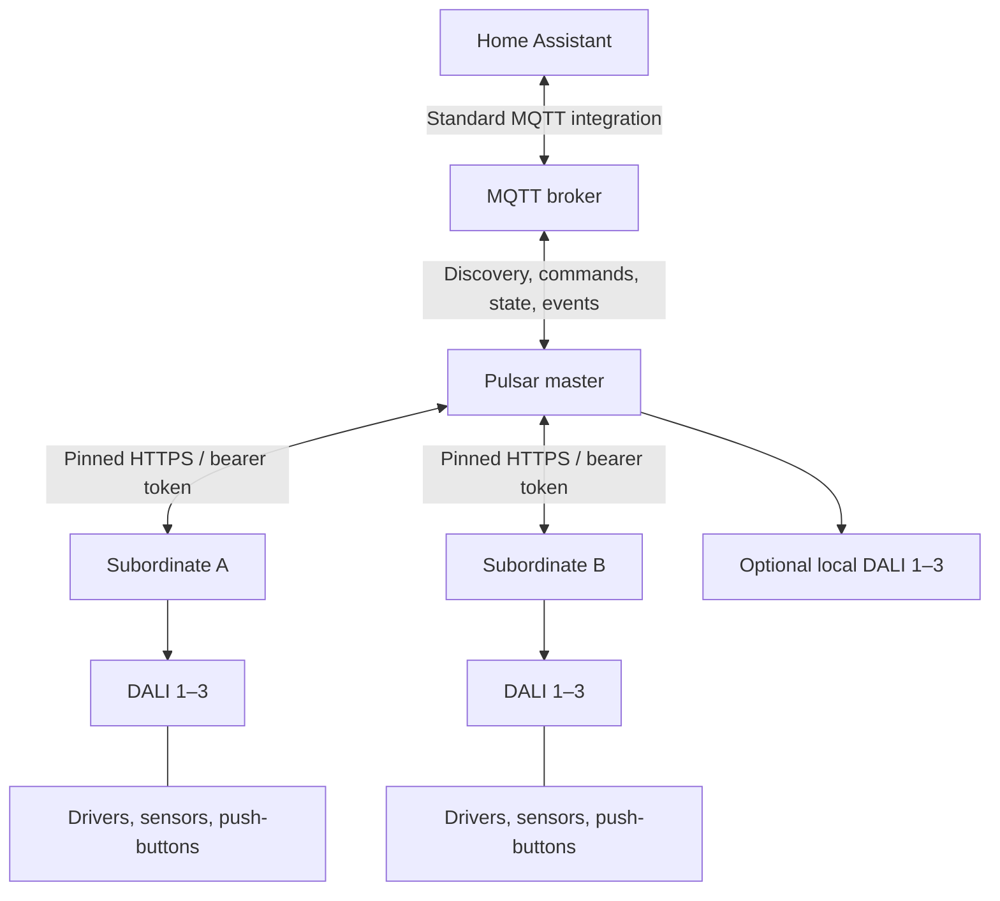

# Pulsar DALI All-in-One

**Local DALI control, commissioning, multi-controller management and native Home Assistant MQTT Discovery in one app.**


[](https://github.com/lennert1986/pulsar-dali-all-in-one/actions/workflows/validate.yml)
[](https://my.home-assistant.io/redirect/supervisor_add_addon_repository/?repository_url=https%3A%2F%2Fgithub.com%2Flennert1986%2Fpulsar-dali-all-in-one)

Pulsar DALI All-in-One is an independent, experimental Home Assistant app (formerly called an add-on) for compatible Glamox / ES-SYSTEM Pulsar and Vertex controller hardware. It combines access to three local DALI buses, device configuration, commissioning, diagnostics and an MQTT bridge. Multiple controllers can be managed from a single master without installing a separate Pulsar custom integration in Home Assistant.

The project is intended for installations that need direct DALI access and local operation as well as a unified Home Assistant interface. A hardware controller can handle local push-button bindings without a running MQTT broker or a Home Assistant automation, while the master can expose registered controllers to one central MQTT broker.

> **Experimental software.** Current app version: **0.23.1**. Automated software validation is not equivalent to DALI certification, electrical commissioning, a real HAOS installation test or verification on every driver, sensor and controller model. Test changes on isolated hardware before deploying them to an occupied installation. This repository is not an official manufacturer product or a certified emergency-lighting system.

## Contents

- [Feature overview](#feature-overview)
- [Architecture and hardware](#architecture-and-hardware)
- [Installation](#installation)
- [First startup and commissioning](#first-startup-and-commissioning)
- [Multiple controllers](#multiple-controllers)
- [Home Assistant and MQTT](#home-assistant-and-mqtt)
- [Web interface](#web-interface)
- [DALI device configuration](#dali-device-configuration)
- [DALI-2 push-buttons and feedback LEDs](#dali-2-push-buttons-and-feedback-leds)
- [Energy monitoring and D4i](#energy-monitoring-and-d4i)
- [Emergency lighting](#emergency-lighting)
- [Test Lab and diagnostics](#test-lab-and-diagnostics)
- [Backup, restore and maintenance](#backup-restore-and-maintenance)
- [Configuration reference](#configuration-reference)
- [Security and networking](#security-and-networking)
- [Troubleshooting](#troubleshooting)
- [Development and validation](#development-and-validation)
- [Known limitations and roadmap](#known-limitations-and-roadmap)
- [Documentation and version history](#documentation-and-version-history)

## Feature overview

**Implemented** means that the functionality exists in the source code. Features described as optional must be enabled or configured before use. Advanced hardware functions remain experimental unless separately verified on the actual installation.

| Area | Capabilities in 0.23.1 | Notes |
| --- | --- | --- |
| Local DALI | Three independent buses, gear scanning, direct arc levels, relay/switch control, groups and scenes | Compatible local STM32/UART hardware required |
| Commissioning | Address discovery, address conflict handling, unaddressed gear commissioning and backups | Use an isolated test bus for risky addressing operations |
| DT6 | LED gear, level parameters, fade time/rate and dimming curve | Basic DT6 capability reads have been observed on one physical test setup |
| DT8 | Tunable white, supported RGBWAF and CIE xy colour controls | MQTT colour control opt-in; actual reported capabilities determine options |
| DALI-2 inputs | Push-button events, occupancy, absolute input and relative illuminance | Input instances are discovered separately from control gear |
| Feedback LEDs | Part 332 capability reads, activate/stop, active/inactive brightness and colour, timing | Experimental; manual configuration requires explicit confirmation |
| Local buttons | Short/long press actions, toggle/on/off and stepped dimming | Opt-in; same-bus gear or group |
| Automatic feedback | Follow or inverse target light status | Opt-in through a binding; continuous feedback timing required |
| MQTT | Standard HA Discovery, state, availability, events, configuration and diagnostic entities | No additional Pulsar custom integration |
| Multi-controller | Central management, local/remote device selection and combined snapshot export | One master per subordinate; no cascaded masters |
| Discovery and pairing | Multicast discovery, certificate-bound approval code and individual pairing token | Discovery is opt-in; announcements alone never authorize access |
| IP recovery | Verified local IPv4 address changes | Existing token, TLS pin, controller ID and registry entry retained |
| D4i | Memory reads, sampled energy/power and supported diagnostics | Optional polling; stale and missing readings are excluded |
| DT1 | Emergency status, battery estimate, manual test commands and audit history | Not a certified emergency maintenance system |
| Maintenance | Resource and communication diagnostics, optional daily cached backup | Combined export is not a full restorable backup |
| Application clock | Optional reference-based application UTC | Does not set HAOS or operating-system time |

## Architecture and hardware

The master may have its own local DALI hardware or run without local DALI interfaces. Each subordinate operates its own local buses and may be administered through the master's pinned HTTPS connection.



Local buttons are processed on the hardware controller that receives their DALI events. They do not require a round trip through MQTT. The add-on itself must remain running for these software bindings to operate.

### Hardware profiles

| Profile | Interface mapping | I2C | Notes |
| --- | --- | --- | --- |
| `auto` | Detected device-tree model or existing manual UART configuration | Profile dependent | Default; verify detected hardware in diagnostics |
| `vertex_g3` | FTDI 0403:6011 interfaces 00, 01 and 02 | Bus 0 | Experimental mapping, not physically verified on G3 |
| `vertex_g4` | DALI 1: /dev/ttyAMA3; DALI 2: /dev/ttyAMA4; DALI 3: /dev/ttyAMA5 | Bus 1 | CM4-based profile; hardware-dependent verification required |
| `remote_only` | None | None for local DALI | Intended for a hardware-free master |
| `manual` | Three explicitly configured serial devices | Configurable | For installations with non-standard device names |

Supported build architectures are **aarch64** and **amd64**. Architecture support does not imply that every board or Supervisor device mapping is supported. A G3 installation needs a suitable 64-bit Home Assistant environment and FTDI driver. Advanced features on older STM32 firmware, especially 1.x, require separate testing.

If three distinct serial devices cannot be resolved, local DALI is disabled rather than guessing which UART controls which bus. Check the hardware error, correct the profile or device mapping, and restart. The application does not install HAOS, change the bootloader, update STM32 firmware or probe arbitrary USB serial devices.

The MCP23017 activity LED integration controls the DALI indicator bits B5/B3/B1; polarity is configurable. These controller activity LEDs are distinct from DALI-2 feedback LEDs on wall switches.

## Installation

### Requirements

- Home Assistant OS or a compatible Supervisor-managed installation for the app.
- A supported Pulsar/Vertex controller with working serial interfaces for local DALI, or a remote-only host.
- A functioning DALI installation with the appropriate bus power supply and compatible equipment.
- Home Assistant's standard MQTT integration and an MQTT broker, such as Mosquitto, if HA entities are required.
- A trusted local network for multi-controller operation.

### Install the repository

1. Open Home Assistant → **Settings → Apps** (called **Add-ons** in older releases).
2. Open the app store and its **Repositories** menu.
3. Add the repository URL:

   ```text
   https://github.com/lennert1986/pulsar-dali-all-in-one
   ```

4. Refresh the store and install **Pulsar DALI All-in-One**.
5. Review the hardware profile and MQTT settings.
6. Stop the original Pulsar app before starting this one on the same hardware. Disable its old custom integration if it would create duplicate entities.
7. Start the app, check its log and open the web UI. Enable the sidebar entry if desired.

Alternatively, use the Home Assistant repository button at the top of this README.

### Upgrade an existing All-in-One installation

Back up the app's data before an upgrade, then refresh the repository in Home Assistant and install the new version. For a paired installation, update all participating controllers to the same current release before testing new remote functions. Existing compatible pairings and registry entries are intended to be retained; resolve any pre-existing role conflicts locally.

**Migration from the original Pulsar app is not automatic.** All-in-One uses a separate data directory and controller ID. Do not assume that device names, Home Assistant entity IDs, areas, automations, credentials or backups will migrate from the original app. Do not operate two applications against the same physical UARTs or publish duplicate MQTT representations of the same controller.

## First startup and commissioning

Start with a known test installation rather than performing writes against an unknown production bus.

1. Select the correct hardware profile; leave `auto_scan: false` for the first controlled startup.
2. Check the startup log and local hardware status.
3. Open **Test Lab**, select the local controller and the first connected bus, and run **STM32-kommunikation**. Repeat for the other connected buses.
4. Open **Oversigt** (Overview) or **Commissioning** and scan the intended buses.
5. Inspect the discovered control gear, control devices and input instances. Resolve address conflicts before configuration.
6. Verify a known luminaire using basic parameters, fade and capability reads.
7. Test direct light control on that device; configure groups and scenes only when their physical membership is understood.
8. Enable MQTT or optional advanced functions once basic communication is reliable.

The application distinguishes DALI control gear addresses from DALI-2 control device addresses. A wall switch can have multiple input instances at the same control-device address. The same address number can therefore identify different equipment depending on bus and address space.

### Commissioning and address safety

The Commissioning page provides addressing tools, conflict diagnostics and configuration backups. Advanced DALI-2 commissioning addresses one unaddressed control device at a time and requires explicit isolated-bus confirmation. Avoid running multiple commissioning applications concurrently, because DTR registers and addressing sequences are shared bus resources.

Where implemented, advanced gear writes verify the cached UID and physical random address, reject conflicting targets and check readback. A failed operation may have partially changed the installation: inspect the result before retrying.

## Multiple controllers

### Controller roles

Roles are mutually exclusive. A standalone device can become a master by adding remote controllers, or it can accept a master and become a subordinate.

| Capability | Standalone | Master | Subordinate |
| --- | --- | --- | --- |
| Local DALI (when hardware enabled) | Yes | Yes | Yes |
| Add remote controllers | Yes | Yes | No |
| Accept a new master | Yes | No | No |
| Manage several subordinate controllers | No, until enrolled | Yes | No |
| Be managed by another master | Yes, after pairing | No | Existing master only |

A master cannot be paired to another master. Subordinates cannot form cascaded networks or add their own subordinate controllers. Pending outgoing pairing reserves the master role; approved incoming pairing reserves the receiving role. Mixed legacy configurations block remote traffic until the conflict is resolved locally.

The paired master has the full supported remote API permissions. There are deliberately no per-user or per-controller permission tiers. The local Home Assistant interface remains usable on a subordinate.

### Configuration examples

**Hardware-free master** — merge these values into the existing app configuration:

```yaml
hardware_model: remote_only
local_dali_enabled: false
controller_discovery_enabled: true
remote_api_enabled: false
remote_legacy_token_enabled: false
mqtt_enabled: true
mqtt_publish_local: false
mqtt_publish_remote: true
```

**Subordinate hardware controller** — example for a Vertex G4 managed by that master:

```yaml
hardware_model: vertex_g4
local_dali_enabled: true
controller_discovery_enabled: true
remote_api_enabled: true
remote_legacy_token_enabled: false
mqtt_enabled: false
```

Map/allow TCP port **8443** on the receiver in the app's Network settings as required. Restart after changing settings. For a master with its own local buses, select the appropriate hardware profile, enable local DALI and set `mqtt_publish_local: true`.

These examples assume that the master is the only MQTT publisher for the subordinate hardware. A standalone installation can instead publish its own local devices.

### Pair a controller

1. Enable `controller_discovery_enabled` on both controllers and `remote_api_enabled` on the intended subordinate.
2. On the subordinate, open **Controllers → Tillad parring i 5 min.** (Allow pairing).
3. On the master, open **Controllers** and locate the device under **Fundne controllere** (Discovered controllers).
4. Click **Tilføj controller**, give it a recognizable name and compare the entire security code on both screens.
5. Approve on the subordinate using **Godkend**.
6. Confirm **Koden matcher – tilføj** on the master.
7. Verify the controller is listed and use it to inspect a known bus.

The code has 16 hexadecimal characters displayed in groups. Never approve a partial or different code. Discovery information is an unverified hint; pairing is not complete until the certificate-bound code and connection have been verified.

The receiver creates a distinct bearer token. The master stores the token and certificate fingerprint; the subordinate stores a token hash. Credentials are not sent back to the browser. The pairing window expires after five minutes.

### Change or remove a master

Remove the master on the subordinate using **Fjern master**, then remove the obsolete remote registration on the old master. Deleting a registration on the master alone does not revoke the subordinate's stored grant. For a master to become subordinate, remove all of its subordinate registrations and revoke the corresponding grants on those devices.

If upgrading from a version that allowed multiple or conflicting relationships, resolve the conflict locally rather than attempting to bypass the role check. Existing records are not silently deleted.

### Automatic recovery after an IP change

Discovery sends IPv4 multicast advertisements approximately every 15 seconds. Candidates expire after 100 seconds. When the saved LAN IPv4 address stops responding, the master can verify a newly advertised address for the same controller.

Recovery requires:

- Discovery enabled on both devices, and reachable remote HTTPS on the subordinate.
- Matching saved TLS certificate fingerprint.
- Successful authentication with the existing pairing token.
- Matching stable controller ID in the response.

The new IP is saved only after these checks. A working old address is retained, ambiguous verified candidates are rejected, and write commands are not automatically replayed. The registry ID, MQTT identities and stored DALI configuration are not changed by address recovery.

Custom DNS names, WAN addresses and nonstandard remote ports are not automatically rewritten. VLANs and multicast-filtering networks may need manual address management. Certificate replacement requires trusted verification and re-pairing.

## Home Assistant and MQTT

The app uses the standard Home Assistant MQTT integration. Install a broker separately. When `mqtt_host` is empty, the bridge tries to use the Supervisor MQTT service; alternatively supply a broker host, port and credentials. Enable `mqtt_tls` for normal certificate/hostname-validated MQTT TLS when required.

### Entities and capabilities

| Home Assistant entity | Examples |
| --- | --- |
| Light | DALI gear and groups; brightness; optional reported DT8 colour mode |
| Switch | Relay-type control gear |
| Scene | Activate an existing DALI scene |
| Event | Individual DALI-2 push-button instance |
| Binary sensor | Occupancy and supported diagnostic problem flags |
| Sensor | Relative illuminance, input values, supported sampled energy and diagnostics |
| Number | Supported gear configuration and fade parameters (some disabled by default) |
| Button | Scan, identify, on-demand reads, and optional feedback activate/stop |

Discovery is capability-aware. An unavailable or unsupported measurement is not a fabricated zero. DT8 modes and extra diagnostics depend on valid reported properties. Configuration/diagnostic entities may need to be enabled in the Home Assistant entity registry.

The MQTT bridge retains discovery, state and availability as appropriate. Push-button events and commands are not retained. The normal discovery prefix is `homeassistant` and the application topic namespace is `pulsar_dali_aio/#`. The broker user needs appropriate access to both.

### Publisher ownership and identity

Only one publisher should represent a physical controller on a given broker. If the master publishes remote devices, disable duplicate local publishing on the subordinate. Remote controller IP changes retain their controller IDs and registry identity, so normal MQTT unique IDs are preserved.

Gear IDs use the stored gear identity where available. Input entities are based on controller, bus, control-device address and instance. Automatic identity transfer to replacement input or gear hardware is not a general migration guarantee. Verify Home Assistant automations after replacement or readdressing.

Changing broker or discovery prefix can leave retained discovery records on the former broker; clean only the relevant obsolete topics before removing the old publisher.

### DT8 MQTT colour control

Enable `dt8_mqtt_enabled: true` on the publishing app, inspect compatible DT8 gear and verify its supported colour features. The bridge exposes the supported active mode when it has valid actual values. Tunable white, RGB/RGBW and CIE xy are implemented; RGBWAF with five/six channels remains web-only. CIE xy coordinates must be within the valid coordinate range and their sum must not exceed one. A reported gamut/readback mismatch is not silently treated as success.

## Web interface

The responsive UI has twelve main pages and remembers the selected controller where applicable. The interface uses Danish labels; the explanations below include their English meanings.

| Page | Purpose |
| --- | --- |
| **Oversigt** | Buses, gear, groups, scenes and day-to-day control |
| **Konfiguration** | Select controller → bus → device; configure only relevant actions |
| **Automatik** | Local occupancy, daylight, schedules and override |
| **Hardware** | SPI, encryption metadata, eMMC, RTC and host-visible diagnostics |
| **Energi** | Sampled D4i measurements and measurement coverage |
| **Nødbelysning** | Emergency status and command history |
| **Vedligeholdelse** | Backups, resource status, communication and combined export |
| **Commissioning** | Addressing, conflicts and configuration backups |
| **Controllers** | Discovery, pairing, registry and controller roles |
| **Remote** | Secured incoming HTTPS access information |
| **Diagnostik** | Technical status and raw API information |
| **Test Lab** | Diagnostic queries, telegram tracing and JSON export |

Remote-capable device operations are routed to the selected controller; local host/resource diagnostics are not automatically aggregated. Always verify the selected controller and bus before applying a configuration change.

## DALI device configuration

The Configuration page is device-first. Select a scanned gear or input instance, inspect its current data and choose a supported action. Offline or conflicting devices are not valid targets for normal advanced operations.

### DT6 and standard gear parameters

- Device name and identification.
- Minimum and maximum arc level.
- Power-on level and system failure level.
- Fade time, fade rate and extended fade time where supported.
- DT6 log/linear dimming curve.
- Group membership and scene levels through the existing management tools.

Raw DALI level codes are not linear percentages of visible light output. Special values, reserved codes and gear-specific limits must be interpreted appropriately. A readback confirms the stored parameter, not the physical brightness.

### DT8 colour control

The web configuration exposes supported tunable white, RGBWAF and CIE xy operations. Actual device capabilities determine which controls are appropriate. Colour temperature uses the supported device range. The UI provides a colour picker and Kelvin slider in relevant modes; editing a value does not itself send a command. Apply explicitly and check the returned readback.

### DALI-2 input configuration

Input instances can report push-button, absolute input, occupancy and relative illuminance types. Supported configuration includes instance enable, event scheme, priority, event filter, group assignments and type-specific timers/settings.

The Part 301 push-button event filter is labelled by function. Other instance-specific masks may be presented as raw bits. Relative illuminance is not calibrated lux. Unknown properties remain unknown rather than being inferred from another type.

## DALI-2 push-buttons and feedback LEDs

Version 0.21.4 adds local button actions and configurable Part 332 feedback. These functions are experimental and have not yet been verified on a physical feedback-capable push-button.

### Available push-button events

The MQTT bridge supports the existing event types:

| Event | Meaning |
| --- | --- |
| `button_pressed`, `button_released` | Button transitions |
| `short_press`, `double_press` | Recognized short/double press |
| `long_press_start`, `long_press_repeat`, `long_press_stop` | Long-press lifecycle |
| `button_free`, `button_stuck` | Button condition |
| `button_event` | Generic button event |

Whether an event is delivered depends on the device, its event scheme and filter. Local bindings currently use short press and long-press start/repeat; the other events remain available for HA automations where reported.

### Set up local button control

On the hardware controller, merge:

```yaml
local_button_bindings_enabled: true
```

Restart and scan the bus. In **Konfiguration**, select the button instance and:

1. Enable the instance and select event scheme **2** (device/instance addressing).
2. Enable event filter bit 2 for short press and bit 4 for long press start; enable bit 5 if using repeat dimming.
3. Open **Lokal knapstyring → Konfigurér lokal tilknytning**.
4. Choose one same-bus gear or a group of known gear (maximum 16 members).
5. Select short and long actions: none, toggle, on, off, dim up or dim down.
6. Select optional LED follow/inverse behaviour and save explicitly.

Local dimming uses steps of 20 DALI arc codes; toggle turns all verified target members off if any is on, otherwise on. The worker checks target identity and membership and reads actual levels before sending commands. Old or busy-operation events may be dropped rather than replayed. It is not a real-time guaranteed control loop.

Avoid conflicting HA automations for the same local button. Remove bindings before replacing or readdressing the input hardware. If a target is replaced or group membership changes, review and re-save the binding.

### Feedback capability and manual test

Part 332 feedback is separate from the Part 301 button function. Scan detects reported feedback capabilities on generic and push-button instances. **Test Lab → DALI-2 input** includes optional feedback queries. **Konfiguration → Feedback-LED** provides capability reads, manual activate/stop and parameter configuration.

Only freshly confirmed visible-only features are allowed to execute the feedback write operations. Audible feedback is not controlled by this implementation. A no-reply response may mean unsupported hardware, an inactive feature or a communication failure; it is not proof of any one of those conditions.

### Brightness, colour and timing

Use **Indstil LED-lysstyrke / farve** with explicit isolated-test-bus confirmation.

| Parameter | Raw range / example |
| --- | --- |
| Active brightness | 0–255 |
| Inactive brightness | 0–255 |
| Active colour | 1–63 |
| Inactive colour | 1–63 |
| Feedback timing | 0–255; use 255 for continuous feedback |

Colour uses two bits per RGB channel (0–3): red + 4 × green + 16 × blue. Example codes: red 3, green 12, blue 48, white 63. Black/off is represented through brightness 0. The device must report the necessary brightness/colour capability. Not all devices support variable brightness or multiple colours.

Configuration writes are sent using DTR0 and a send-twice command with exact readback. Redundant persistent writes are avoided. Do not perform configuration while other commissioning operations are active.

### Automatic feedback from actual light status

Set the device to continuous feedback timing and configure its binding:

| Mode | Behaviour |
| --- | --- |
| None/manual | No automatic feedback ownership |
| Follow | Active when any linked target gear reports an actual level above zero |
| Inverse | Active when all linked gear reports zero |

The worker uses live DALI readings, not merely the last commanded MQTT level. It processes one feedback binding per approximately three-second cycle and periodically reasserts the state. More bindings, busy buses and communication errors increase latency. Automatic operation does not rewrite permanent feedback settings.

Active and inactive are device modes, not guaranteed physical LED on and off states: for example, an inactive brightness of 10 can leave an orientation light visible.

### MQTT feedback control

Enable on the target hardware controller:

```yaml
feedback_mqtt_enabled: true
```

Scan the supported button and set continuous timing. The bridge discovers **Activate feedback** and **Stop feedback** MQTT buttons for compatible visible-only features that have no automatic follow/inverse owner. The master can publish the corresponding remote entities. Manual MQTT control is rejected when an automatic binding owns the feedback.

The feedback entities are buttons rather than optimistic on/off lights, because STOP may select a nonzero inactive brightness and a silent query does not prove that the LED is off.

Local bindings are stored in `/data/button_bindings.json`. Back up this file separately. At present, cross-bus, cross-controller and scene bindings are not implemented.

## Energy monitoring and D4i

The Energy page aggregates fresh valid supported D4i measurements. It shows measurement coverage rather than treating unmeasured drivers as zero consumption.

Read memory bank 0 first to establish identification and advertised memory-bank information. The raw memory reader accepts bank numbers 0–255; decoded values require the supported bank layout and valid bytes.

| Bank | Typical purpose in the application |
| --- | --- |
| 0 | Device identification, versions, GTIN and advertised banks |
| 1 | Manufacturer/luminaire data |
| 202 | Active energy and power |
| 203 | Apparent energy and power |
| 204 | Output-side energy data |
| 205 | Driver diagnostics |
| 206 | Light-source diagnostics |
| 207 | Raw data |

Available readings depend on the driver and bank layout. Bank 207 is raw, not decoded telemetry. Missing, invalid and stale values are excluded from valid totals. The normal freshness limit is 15 minutes.

Optional polling settings:

```yaml
auto_identify: true
d4i_poll_enabled: true
d4i_poll_interval: 900
```

The low-priority worker processes a limited number of reads, yields to normal operations and skips busy scans. The configured interval is a best-effort sampling interval, not a guaranteed update rate for every driver. These readings are not a certified billing meter. Verify actual device support before relying on them.

## Emergency lighting

The Emergency page provides available DT1 status, failure indicators, raw battery charge/estimate and manual test command history. Manual function/duration/stop operations require explicit confirmation on an isolated test bus.

A sent command or successful protocol reply is not a passed emergency-lighting test. There is no certified automatic emergency test schedule or acceptance report. Do not use this app as the sole compliance record or safety controller in a life-safety installation. Follow the luminaire manufacturer's procedure and applicable inspection requirements.

## Test Lab and diagnostics

Test Lab is intentionally separate from Configuration and provides diagnostic read operations. Choose the controller, DALI bus, test type and a scanned device/instance as required.

| Test type | What it examines |
| --- | --- |
| STM32 communication | GVER firmware and UART communication |
| Basic parameters | Status, device type, level, physical minimum, groups and related parameters |
| Fade parameters | Raw fade time/rate and optional extended fade |
| DT6 / DT8 / DT1 capabilities | Reported device types and relevant feature/status queries |
| Memory banks / D4i raw data | Bank and byte ranges, including missing bytes |
| DALI-2 input | Device/instance status, type, resolution, event settings and optional feedback |

Capability and memory tests may use temporary DTR/device-type commands. Confirm these operations only when other commissioning is stopped. Memory tests read up to 16 bytes at a time. The diagnostic runner uses a time budget between telegrams; an individual transport operation may still take longer.

Results include pass, no reply, error, skipped and unknown counts, elapsed time and a telegram log. TX is the encoded request to the STM32; RX is the validated response payload, not a captured electrical bus waveform. Export JSON when reporting a problem.

A successful physical DT6 capability test has been observed with STM32 firmware 2.1.14, DALI 1, address 0: firmware read, random address, DT6 type, reported types and dimming curve all replied successfully. This is a limited observation, not a guarantee of other devices or advanced write support.

## Backup, restore and maintenance

The Maintenance and Commissioning pages provide backup and diagnostic tools. Cached configuration backups preserve available configuration data. An optional daily cached snapshot is enabled using `auto_backup_enabled: true`. Restore offers planning and application to eligible devices, with identity checks and supported parameter/group/scene readback.

Restore is not transactional: it may apply some changes before encountering an error. Review the plan and back up the target before applying. Keep a separate Supervisor/app-data backup for disaster recovery, including controller registry, TLS credentials, pairing grants and local button bindings.

The combined installation JSON export includes local and enrolled controller snapshots and per-controller errors. **It is an inspection/export format, not a full restorable installation backup.** Keep exports private if they contain installation inventory.

The local Maintenance page includes resources, UART/transaction statistics and application clock status. Emergency command history has bounded rotation; general logs are managed by Home Assistant.

### Application clock

On a master, `clock_reference_controller_id` can select an enrolled pinned HTTPS peer using its own system time. `clock_sync_interval` defaults to 60 seconds. Round-trip compensation and monotonic holdover are used; slow samples and chained references are rejected, and holdover expires after 900 seconds.

This synchronizes an application-level UTC estimate only. It does not set the OS/HAOS clock, alter existing event timestamps or replace NTP. The reference system clock must independently be correct. Current exclusive controller roles restrict the usable reference topology.

## Configuration reference

All defaults below are from the current app manifest. Examples are partial overrides; keep the other settings in place.

### Hardware and communication

| Option | Default | Description |
| --- | --- | --- |
| `hardware_model` | `auto` | auto, vertex_g3, vertex_g4, remote_only, manual |
| `local_dali_enabled` | true | Local bus access; false for hardware-free management |
| `dali1_device` | /dev/ttyAMA3 | Manual DALI 1 serial path |
| `dali2_device` | /dev/ttyAMA4 | Manual DALI 2 serial path |
| `dali3_device` | /dev/ttyAMA5 | Manual DALI 3 serial path |
| `baudrate` | 115200 | Serial baud rate; schema 1200–3000000 |
| `response_timeout` | 1.5 | Serial response timeout; schema 0.2–10.0 s |
| `auto_scan` | false | Automatic startup scan when no cached gear exists |
| `poll_interval` | 30 | Normal state polling interval; 5–600 s |
| `led_enabled` | true | Local controller activity LEDs |
| `led_active_high` | true | Controller activity LED polarity |
| `led_pulse_ms` | 80 | Activity pulse duration; 20–1000 ms |
| `i2c_bus` | 1 | I2C bus number; profile may override |
| `mcp_address` | 32 | MCP23017 I2C address (0x20) |

### MQTT

| Option | Default | Description |
| --- | --- | --- |
| `mqtt_enabled` | true | Start MQTT bridge |
| `mqtt_auto_discovery` | true | Publish HA discovery configurations |
| `mqtt_host` | empty | Use Supervisor MQTT service when empty |
| `mqtt_port` | 1883 | Broker port |
| `mqtt_username` | empty | Broker username |
| `mqtt_password` | empty | Broker password; treat as secret |
| `mqtt_tls` | false | TLS with normal CA and hostname validation |
| `mqtt_discovery_prefix` | homeassistant | HA discovery prefix |
| `mqtt_publish_local` | true | Publish local hardware |
| `mqtt_publish_remote` | true | Publish enrolled remote hardware |
| `dt8_mqtt_enabled` | false | Optional DT8 colour discovery/control |
| `feedback_mqtt_enabled` | false | Optional feedback command buttons on target hardware |

### Controllers, maintenance and optional functions

| Option | Default | Description |
| --- | --- | --- |
| `controller_discovery_enabled` | false | Local IPv4 multicast discovery and address recovery |
| `remote_api_enabled` | false | Incoming remote HTTPS server |
| `remote_legacy_token_enabled` | false | Legacy manual shared-token receiver compatibility; not a paired master mode |
| `local_button_bindings_enabled` | false | Enable opt-in local button worker |
| `local_automation_enabled` | false | Enable local zone automation |
| `auto_backup_enabled` | false | Daily cached configuration backup |
| `auto_identify` | true | Low-priority identity/capability reads |
| `d4i_poll_enabled` | false | Optional D4i sampling |
| `d4i_poll_interval` | 900 | Sampling interval; schema 300–3600 s |
| `clock_reference_controller_id` | empty | Optional pinned application-clock reference |
| `clock_sync_interval` | 60 | Application-clock sync interval; 30–300 s |

For full defaults and accepted types, see [config.yaml](pulsar_dali_all_in_one/config.yaml).

## Security and networking

| Connection | Port / protocol | Purpose |
| --- | --- | --- |
| Local web/API | TCP 8099 | HA ingress and internal local API |
| Remote control | TCP 8443, HTTPS | Authenticated pinned controller-to-controller API |
| Discovery | UDP 38443, multicast 239.255.84.43 | Local candidate advertisements, TTL 1 |
| MQTT | Broker configured port (default 1883) | Home Assistant entity integration |

The manifest uses host networking. Do not expose the unauthenticated local API port 8099 to untrusted clients or the public Internet; keep it behind authenticated Home Assistant ingress and restrict host/firewall access. Port entries are not mapped by default. Enable incoming remote HTTPS only where required. Restrict MQTT and remote API access to trusted networks.

Remote requests use a stored certificate SHA-256 pin and bearer credential, with a restricted set of supported API routes. Pairing administration is restricted to loopback or the recognized ingress source and requires explicit local approval. Discovery does not carry credentials and cannot establish authorization. Treat the displayed discovery role as unverified until the backend checks it.

Legacy shared-token access is off by default. If temporarily enabled for an unpaired legacy receiver, the shared credential can be copied and is not exclusive pairing. Paired controllers reject the legacy token. Prefer secure pairing; protect app-data backups containing credentials. Rotate or revoke credentials if compromise is suspected.

## Troubleshooting

| Symptom | Checks |
| --- | --- |
| No local hardware / UART error | Verify hardware profile, actual serial device mapping and unique devices; stop other apps accessing the UART |
| STM32 GVER no reply | Check bus selection, UART, baud rate and controller firmware; test communication before scanning |
| No gear discovered | Verify DALI wiring and supply, physical device response and addressing; do not assume no reply means absence |
| Gear address conflict | Resolve conflicts in Commissioning before writes |
| Controller not discovered | Enable discovery on both, remote HTTPS on receiver, check UDP multicast/firewall/VLAN and TCP 8443 |
| Pairing rejected | Check receiver's five-minute window, role, entire matching security code and HTTPS connection |
| Already has a master | Remove existing master locally and remove obsolete master registry entry |
| Changed IP not recovered | Check both discovery settings, saved LAN IPv4 address, matching TLS pin, ID and token; use manual update if needed |
| No HA entities | Verify broker, standard MQTT integration, discovery prefix, publisher ownership and online bus |
| Duplicate entities | Disable competing publisher or legacy custom integration; review retained discovery records |
| DT8 colour unavailable | Inspect actual supported features, verify valid colour readings and enable optional MQTT mode |
| Push-button events missing | Scan the input, verify enabled instance, event scheme 2 and appropriate event filter |
| Local binding not running | Enable local bindings on the hardware controller; verify target identity, membership and live levels |
| Feedback unavailable | Read Part 332 capability; confirm visible-only feature, no conflict and continuous timing for automatic/MQTT control |
| Feedback stop does not extinguish LED | Check inactive brightness; STOP changes feedback mode, not necessarily physical illumination |
| Energy data missing | Read bank 0, verify supported bank and valid/fresh data; allow polling time |
| Restore mismatch | Stop and inspect readback and partial changes before retrying |

When opening an issue, provide the app version, hardware model, STM32 firmware, relevant controller role, bus/address/instance, exact action, sanitized log and Test Lab JSON. Remove passwords, tokens, private keys and other secrets.

[Open an issue](https://github.com/lennert1986/pulsar-dali-all-in-one/issues/new)

## Development and validation

The running Python source is reconstructed from the pinned compressed base files plus the transformations in `build_source.py`. Additional modules implement advanced features. Do not edit the generated runtime as the sole source of truth.

```text
pulsar_dali_all_in_one/
  config.yaml             Home Assistant app manifest and settings
  build.yaml              Build architecture configuration
  Dockerfile              Runtime image
  build_source.py         Reconstructs and patches the runtime
  base/                   Pinned compressed source fragments
  app/
    advanced.py           Advanced DALI configuration
    feedback.py           IEC 62386-332 feedback operations
    button_bindings.py    Local actions and feedback worker
    mqtt_bridge.py        Home Assistant MQTT Discovery and routing
    test_lab.py           Diagnostic runner and configuration UI
    ui_layout.py          Common page layout/navigation
    hardware_profile.py   Vertex hardware mapping
    discovery.py          Multicast discovery
    pairing.py            Pairing, role checks and grant storage
    pairing_ui.py         Controller pairing interface
    reconnect.py          Verified address recovery
    clock_sync.py         Application-clock synchronization
    maintenance.py        Low-priority enrichment and backups
    dashboards.py         Energy/emergency/maintenance UI
    test_*.py             Automated tests
  DOCS.md                 Detailed configuration/release notes
  CHANGELOG.md            Version history
.github/workflows/
  validate.yml            Automated build and test workflow
```

To reconstruct and run representative checks in a suitable Python/Node development environment:

```bash
cd pulsar_dali_all_in_one
python3 -m pip install paho-mqtt pyserial pyyaml
python3 build_source.py app/pulsar_dali_control.py
python3 -m py_compile app/*.py
python3 app/test_bridge.py
python3 app/test_hardware_profile.py
python3 app/test_lab_checks.py
python3 app/test_advanced.py
python3 app/test_feedback.py
python3 app/test_button_bindings.py
python3 app/test_maintenance.py
python3 app/test_ui_layout.py
python3 app/test_pairing.py
python3 app/test_reconnect.py
```

The GitHub workflow also checks JavaScript syntax for the diagnostic/configuration and pairing interfaces. See the [complete workflow](.github/workflows/validate.yml) and [validation runs](https://github.com/lennert1986/pulsar-dali-all-in-one/actions/workflows/validate.yml).

## Known limitations and roadmap

The main development focus is now physical validation and reliability rather than claiming all protocol features are production-ready.

| Area | Remaining work / limitation |
| --- | --- |
| DALI-2 feedback and local bindings | Physical LED, button events, persistent parameters and feedback timing verification |
| DT8 | Physical validation of supported colour modes, gamut clipping and readback |
| Vertex G3 | Verify FTDI mapping, older STM32 firmware and advanced operations |
| Multi-controller | Physical HA ingress, secure pairing, DHCP recovery and role-transition testing |
| Identity migration | Explicit, verified replacement workflow preserving HA identities |
| Local bindings | Potential future scene, cross-bus and cross-controller destinations |
| Diagnostics | Broader device compatibility and long-running bus performance measurements |
| Backups | A complete multi-controller restore workflow beyond snapshot export |
| Emergency | No certified test system; independent approved procedures required |

Individual permission tiers are intentionally not planned: the supported master relationship grants full remote API access. The master/subordinate restriction is a design choice.

New experimental capabilities are opt-in where appropriate. Test hardware compatibility and maintain a usable rollback/backup before production use.

## Documentation and version history

- [App README](pulsar_dali_all_in_one/README.md) — quick-start for the installed app.
- [Detailed configuration and release notes](pulsar_dali_all_in_one/DOCS.md) — includes historical sections; earlier limitations may be superseded by newer sections.
- [Full changelog](pulsar_dali_all_in_one/CHANGELOG.md).
- [App manifest](pulsar_dali_all_in_one/config.yaml).
- [Current main branch](https://github.com/lennert1986/pulsar-dali-all-in-one/tree/main).
- [Previous version archive: 0.21.3](https://github.com/lennert1986/pulsar-dali-all-in-one/tree/archive/v0.21.3).

| Version | Main changes |
| --- | --- |
| **0.23.1** | Optional active JEDEC/SFDP chip identification |
| 0.23.0 | Read-only hardware and encryption metadata, local/remote diagnostics |
| 0.22.0 | Local zone automation, MQTT override and schedules |
| 0.21.4 | Feedback LED settings, local button bindings, automatic status feedback, MQTT feedback buttons |
| 0.21.3 | Part 332 feedback detection and manual diagnostics |
| 0.21.2 | Exclusive master/subordinate roles |
| 0.21.1 | One master per subordinate and verified IP recovery |
| 0.21.0 | Discovery-assisted secure pairing |
| 0.20.3 | DT8 CIE xy configuration and MQTT |
| 0.20.2 | Application-clock synchronization |
| 0.20.1 | Automatic controller discovery |
| 0.20.0 | Combined installation export |
| 0.19.0 | Named push-button event-filter bits |
| 0.18.x | Energy, emergency and maintenance dashboards, backup improvements |
| 0.17.x | Device-first configuration, identity reads, optional D4i and DT8 MQTT |
| 0.16.x | Advanced configuration, shared UI and restore |
| 0.15.0 | Read-only Test Lab |
| 0.14.0 | Experimental Vertex G3/G4 profiles |
| 0.13.0 | All-in-One app, local/remote control and MQTT Discovery |

Maintained by [lennert1986](https://github.com/lennert1986). Manufacturer names are used for hardware identification; no manufacturer endorsement is implied.

## Hardware and local automation (current releases)

Version 0.22.0 adds opt-in local zone automation; enable `local_automation_enabled` on the hardware controller. Version 0.23.0 adds the Hardware page, including read-only SPI device metadata, visible LUKS headers, eMMC, RTC, thermal and system resources, existing STM32/UART status and bounded bus-state history. Select a local or enrolled controller and export JSON. Raw SPI contents and key material are not collected; no device access is expanded. See the latest sections of DOCS.md for limitations and setup. Hardware validation is pending.

### Optional active SPI identification

Set `spi_identification_enabled: true` on the known Vertex G4 hardware and restart. Hardware shows stable JEDEC ID, known family, estimated NOR capacity and supported SFDP density. Only SPI1/CS1 is targeted; no raw flash array data or key material is collected. Actual SPI hardware and container access remain to be verified.
